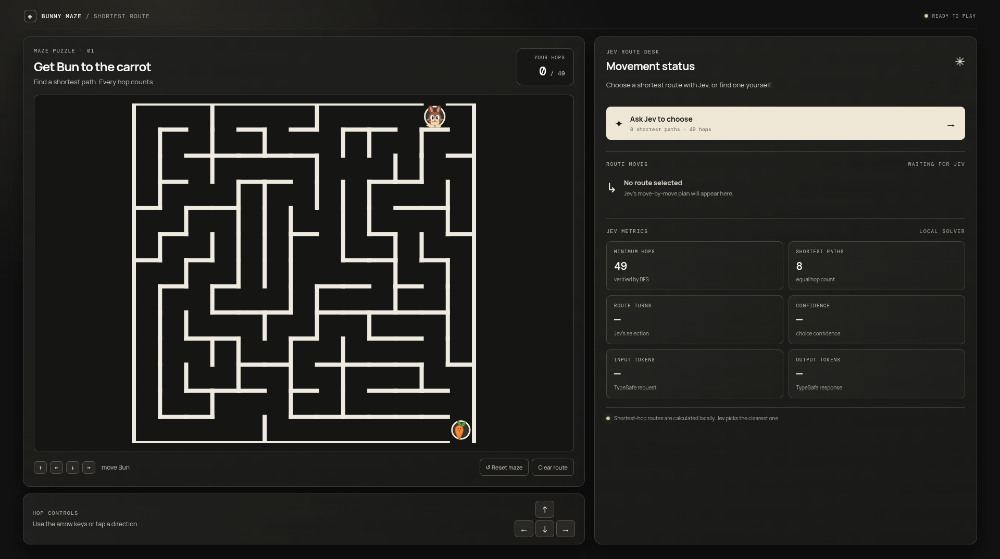

# Bunny Maze — React + Vercel

React maze puzzle built with Vite. It preserves the hand-mapped maze pattern and its alternate paths. Breadth-first search verifies the minimum hop count and enumerates the shortest complete routes. Jev chooses among those routes; the dashboard shows its move sequence and response metrics.

## Interface reference



## Local development

Requires Node.js 20 or newer.

1. Install packages: `npm install`
2. Copy `.env.example` to `.env.local` and set your TypeSafe key:

   ```env
   TYPESAFE_API_KEY=your_typesafe_api_key
   ```

3. Start Vite: `npm run dev`

The Vite dev middleware serves the same `/api/choose-route` handler used in production. The key stays on the server and is never exposed as a `VITE_` variable.

## Deploy to Vercel

Import this project into Vercel. Use the default Vite settings: build command `npm run build`, output directory `dist`. In the Vercel project settings, add `TYPESAFE_API_KEY` under **Environment Variables** for the environments you deploy to, then redeploy. The function in `api/choose-route.js` calls TypeSafe from Vercel's server runtime.

`.env.example` is a template only. Keep the real key in `.env.local` locally and Vercel's environment settings in production; `.env.local` is ignored by Git.
